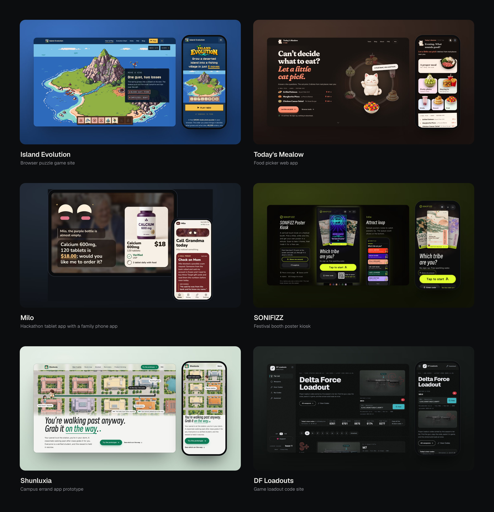

<h1 align="center">award-polish</h1>

**An agent skill for polishing websites, web apps and app interfaces, with Awwwards winners as the bar and reviews you can trust.**

<p align="center">
  <a href="LICENSE"></a>
  &nbsp;
  <a href="https://github.com/Ekko237/award-polish/releases/latest"></a>
  &nbsp;
  <a href="CHANGELOG.md"></a>
</p>

<p align="center"><a href="README.zh.md">中文说明</a></p>

<p align="center">
  
</p>

Tested with Claude Code and Codex. The folder is plain Markdown plus Python, so other agents that load skill folders may work, but they are untested.

## Polished with award-polish

- [Island Evolution](https://islandevolution.com/): a browser puzzle game's website; the scroll-driven walkthrough of one game is the part to see.
- [Today's Mealow](https://mealow.app/): a web app where a cat picks what you eat from real places nearby.
- [Milo](https://devpost.com/software/milo-shopping-that-understands-older-adults): a hackathon build by a team of four, a voice-first tablet app for older adults plus a phone app for their families.
- [SONIFIZZ Poster Kiosk](https://ekko237.github.io/sonifizz-poster/) ([code](https://github.com/Ekko237/sonifizz-poster)): a touch-kiosk prototype for a festival booth that prints your own poster in a minute.
- [Shunluxia](https://ekko237.github.io/shunluxia-campus-errand/?lang=en) ([code](https://github.com/Ekko237/shunluxia-campus-errand)): a campus errand app prototype where classmates already walking past the parcel station bring your package back.
- [DF Loadouts](https://dfgqm.com/en): a game loadout code site, polished over two redesign rounds.

Given the same brief, everyone ships about the same features. What makes one product stand out is visuals, interaction, motion and smoothness, and that is hard to improve with an AI agent alone: it grades its own work generously, small fixes stall, and "make it better" has no finish line. This skill turns polishing into a loop with a real ruler.

Anything that runs in a browser fits, from marketing sites to tablet app interfaces, because the checks drive a headless browser.

Awwwards is the bar, not a promise: none of these has won an Awwwards award.

How the loop works:

- **Study the bar first**: open 6-8 recent Awwwards / Webby / FWA winners of the same kind, note the techniques worth borrowing.
- **Work in batches**: reviewers hand over one complete issue list, the agent fixes all of it, one commit per fix, then the next review.
- **Reviews you can trust**: two fresh reviewers who did not build it, a fixed anchor set to cancel out harsh or lenient reviewers, and a blind side-by-side against the best version so far that decides whether a batch counts. The 10-item ruler was calibrated on 5 real Sites of the Day and a template site: 10 = top SOTD, 9 = average SOTD, 8 = Honorable Mention.
- **You stay the final judge**: before/after images go to you regularly, because AI reviewers can all miss the same thing; the version you pick becomes the baseline no score overrides.
- **Brakes for every case**: deadlines, being stuck, no progress, flip-flopping.
- **Hackathons and team work**: same bar, design moves before the start, polishing follows the team's checkpoints.


## Try one tool in a minute

The layout checker works on any site, no skill install needed:

```bash
git clone https://github.com/Ekko237/award-polish && cd award-polish
pip install playwright pillow && playwright install chromium
python3 skills/award-polish/scripts/layout_check.py https://your-site.com --out check --keep "main=.your-main-button"
```

You get screenshots at 375, 768, 1024, 1280 and 1440 plus `check/report.json`: horizontal overflow, clipped outlines and shadows, truncated text, headings over two lines, console errors, broken images, tap targets under 44px, text rendered under 12px, and whether your main button is fully in the first screen and not covered by a banner.

## Install

```bash
npx skills add https://github.com/Ekko237/award-polish -a claude-code -a codex
```

That installs the skill with the [`npx skills`](https://github.com/vercel-labs/agent-skills) CLI.

<details>
<summary>Claude Code plugin</summary>

Claude Code:

```bash
claude plugin install award-polish --marketplace Ekko237/award-polish
```

</details>

<details>
<summary>Codex plugin</summary>

Codex:

```bash
codex plugin marketplace add Ekko237/award-polish
codex plugin add award-polish@award-polish
```

</details>

These commands install the skill. Python packages are separate: Python 3, Playwright with Chromium, and Pillow. `asset_check.py` also needs beautifulsoup4 and tinycss2. `seo_keep.py` needs requests and beautifulsoup4. Optional: a front-end design skill such as design-taste-frontend, and an image generator.

Verify: ask "polish this site to award level". You should see a short reply, and `ITERATION_LOG.md` with the mode on the first line (new site or redesign).

The skill text is English. The agent still replies in your language.

<details>
<summary>Folder install</summary>

```bash
git clone https://github.com/Ekko237/award-polish && cd award-polish && bash install.sh
```

The installer uses rsync. It installs into `~/.claude/skills/award-polish`, `~/.codex/skills/award-polish`, or both, wherever `~/.claude` or `~/.codex` already exists. If neither exists, the script stops and asks for a skills path.

Update: in the clone, run `git pull` and then `bash install.sh`. The copy keeps extra files you added in the installed folder.

From a checkout you already have:

```bash
bash install.sh
```

Claude Code only, or Codex only:

```bash
bash install.sh claude
bash install.sh codex
```

A chosen skills folder:

```bash
bash install.sh /path/to/skills
```

On Windows, copy `skills/award-polish` to `%USERPROFILE%\.claude\skills\award-polish` or `%USERPROFILE%\.codex\skills\award-polish`. Git Bash can run `install.sh` when `rsync` is installed.

Claude Code and Codex can also be pointed at `skills/award-polish/SKILL.md`. Slash commands take `/award-polish`.

</details>

## What is inside

- `skills/award-polish/SKILL.md`: the loop (goal, process, check and iterate), finish conditions and red lines.
- `skills/award-polish/references/`: new-site and redesign modes, how to study award sites, the scoring ruler, how to run reviewers, the polish checklist, shipping, hackathons, and lessons from real projects.
- `skills/award-polish/templates/`: the polish brief, iteration log, reviewer prompt and reviewer config.

`skills/award-polish/scripts/` (usage in `skills/award-polish/references/scripts.md`), all run on real sites:

| Script | What it does |
| --- | --- |
| `layout_check.py` | multi-width screenshots and layout checks, key elements in the first screen, states after interactions. |
| `record_moment.py` | frame-by-frame recording of animations on a virtual clock, so reviewers can judge motion from stills. |
| `sound_levels.py` | per-step audio levels, for reviewers who cannot hear in a headless browser. |
| `review_prompt.py` | blind reviewer prompts with anonymized screenshot sets. |
| `calibrate.py` | anchor calibration, averaging, Awwwards-weighted scores, and the verdict from the blind side-by-side. |
| `side_by_side.py` | labelled before/after images from URLs or files. |
| `seo_keep.py` | titles, descriptions, canonicals and structured data before vs after, so a redesign never loses search fields. |
| `wait_live.py` | waits until the live page and its CSS and JS really serve the new version. |
| `asset_check.py` | every local file every page references exists, without a browser. |
| `snapshot.py` | review snapshots exported from commits only, so nothing uncommitted turns into a 404. |
| `split_commits.py` | splits piled-up changes into one commit each by keyword. |

## Common Questions

**Does a project need an Awwwards win?**

Awwwards is the bar the loop aims at. None of the projects above has won an Awwwards award.

**Which browser does the checker use?**

Playwright's headless Chromium. The layout, motion, sound, side-by-side and live-wait scripts all launch that Chromium.

**Does it change my SEO?**

On a redesign it keeps the search fields already on the site: title, description, canonical, hreflang, structured data, H1 and the share card. `seo_keep.py` compares the live site with the new build, and a release waits until that diff is empty. Reviewer ideas to reword the H1, title or description stay out unless you approve them.

**Which agents is it tested with?**

Claude Code and Codex. Other agents that load a skill folder may work. They are untested.

**Can I try a check without installing the skill?**

Yes. Clone the repo and run the layout checker. See [Try one tool in a minute](#try-one-tool-in-a-minute).

## License

MIT

<sub>Tried it? Open an issue and tell me what broke or what you made.</sub>
