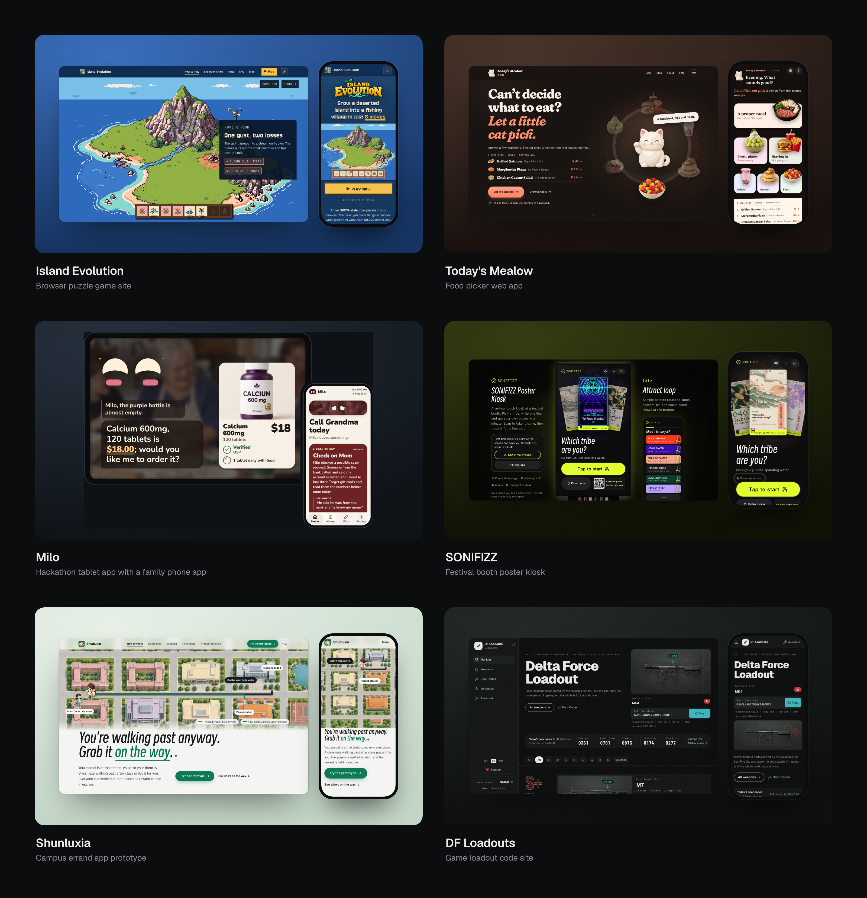
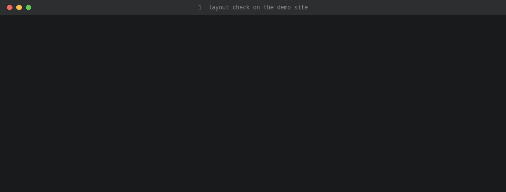

# award-polish

[English](README.md) | [简体中文](README.zh.md)

award-polish is a Claude Code and Codex skill for reviewing and refining websites, web apps, and browser-based prototypes in batches.



Desktop and mobile screenshots of six projects polished with this skill.

## Who it's for

Indie developers and small teams using AI to build landing pages, portfolios, or web apps. If you're redesigning a browser game's homepage, for example, check whether the main button is visible on mobile, then compare the redesign with the best version so far.

## Why try it now

When the page already works and the next instruction is “make it better,” two independent reviewers use a shared rubric to give you a full list of fixes. After each batch, they calibrate against a fixed set of examples and compare the result blind against the best version so far. The version you pick becomes the baseline.

The v1.0.4 release uses a 10-item rubric calibrated on five real Awwwards Sites of the Day and one template site. A 10 means top Site of the Day, 9 means average Site of the Day, and 8 means Honorable Mention.

```bash
npx skills add https://github.com/Ekko237/award-polish -a claude-code -a codex
```

[Quick use](#quick-use) · [Report an issue](https://github.com/Ekko237/award-polish/issues) · [Contributing](CONTRIBUTING.md) · [ClawHub](https://clawhub.ai/ekko237/skills/award-polish)

## Requirements

- To install the skill, use Git and Node.js with `npx`. Run the command above in your project directory and choose **Project** when asked for an install scope. In a non-interactive terminal, append `-y` to accept the default project install.
- The full workflow requires a signed-in Claude Code or Codex session. Other agents that load skill folders are untested.
- The layout checker uses Git, Python 3 with `venv`, Playwright's Chromium, and Pillow. The example below installs the Python packages and browser and runs without an agent login.
- `asset_check.py` also needs beautifulsoup4 and tinycss2. `seo_keep.py` also needs requests and beautifulsoup4.

## Quick use

### Run a local layout check

Run these commands in an empty directory. A local Python server hosts the example page. First-time setup downloads Chromium.

```bash
git clone https://github.com/Ekko237/award-polish
cd award-polish
python3 -m venv .venv
.venv/bin/python -m pip install playwright pillow
.venv/bin/python -m playwright install chromium
mkdir demo
cat > demo/index.html <<'HTML'
<!doctype html>
<html lang="en">
<meta charset="utf-8">
<meta name="viewport" content="width=device-width, initial-scale=1">
<title>Layout check demo</title>
<h1>Layout check demo</h1>
<button id="start" style="min-height:44px">Start</button>
</html>
HTML
.venv/bin/python -m http.server 8765 --bind 127.0.0.1 --directory demo
```

In a second terminal, go to the cloned `award-polish` directory and run the check.

```bash
.venv/bin/python skills/award-polish/scripts/layout_check.py http://127.0.0.1:8765/ --out check --keep 'start=#start'
```

Open `check/report.json` for results such as horizontal overflow, truncated text, and whether the Start button is fully visible and uncovered. `check/` also contains screenshots at 375, 768, 1024, 1280, and 1440 pixels wide. Press Ctrl+C in the first terminal when you're done.

### Start the polish workflow

With the project install above, look for `.agents/skills/award-polish/SKILL.md`. The installer also links the skill for Claude Code. Open Claude Code or Codex in your project and ask “Use award-polish on this site. Start with the local homepage and preserve the existing core flow.” Check that the first line of `ITERATION_LOG.md` in your project identifies the mode as a new site or a redesign. [Full workflow](skills/award-polish/SKILL.md) · [Script usage](skills/award-polish/references/scripts.md)

## When not to use it

- For one known CSS issue, fix it directly and check the affected page.
- The layout checker needs a browser-renderable page. It cannot check a native-only screen.
- If you need a guaranteed award, this workflow cannot provide one. It uses Awwwards as a benchmark. The projects below have yet to win an Awwwards award.

## Compared with alternatives

| Approach | Use it when | What you get |
| --- | --- | --- |
| Manual review | You have a known issue and a small change | A targeted check of the affected page and state |
| Layout checker alone | You want to spot layout issues across screen widths | Screenshots at five widths and a JSON report |
| Full award-polish workflow | You want to refine visuals, interaction, and motion in batches | Two independent reviewers, calibrated scores, and a blind side-by-side review |

## Polished with award-polish

- [Island Evolution](https://islandevolution.com/): a browser puzzle game's website; the scroll-driven walkthrough of one game is the part to see.
- [Today's Mealow](https://mealow.app/): a web app where a cat picks what you eat from real places nearby.
- [Milo](https://devpost.com/software/milo-shopping-that-understands-older-adults): a hackathon build by a team of four, a voice-first tablet app for older adults plus a phone app for their families.
- [SONIFIZZ Poster Kiosk](https://ekko237.github.io/sonifizz-poster/) ([code](https://github.com/Ekko237/sonifizz-poster)): a touch-kiosk prototype for a festival booth that prints your own poster in a minute.
- [Shunluxia](https://ekko237.github.io/shunluxia-campus-errand/?lang=en) ([code](https://github.com/Ekko237/shunluxia-campus-errand)): a campus errand app prototype where classmates already walking past the parcel station bring your package back.
- [DF Loadouts](https://dfgqm.com/en): a game loadout code site, polished over two redesign rounds.



## Other ways to install

<details>
<summary>Claude Code plugin</summary>

Claude Code:

```bash
claude plugin install award-polish --marketplace Ekko237/award-polish
```

</details>

<details>
<summary>Codex plugin</summary>

Codex:

```bash
codex plugin marketplace add Ekko237/award-polish
codex plugin add award-polish@award-polish
```

</details>

<details>
<summary>Folder install</summary>

```bash
git clone https://github.com/Ekko237/award-polish && cd award-polish && bash install.sh
```

The installer uses rsync. It installs into `~/.claude/skills/award-polish`, `~/.codex/skills/award-polish`, or both, wherever `~/.claude` or `~/.codex` already exists. If neither exists, the script stops and asks for a skills path.

Update: in the clone, run `git pull` and then `bash install.sh`. The copy keeps extra files you added in the installed folder.

From a checkout you already have:

```bash
bash install.sh
```

Claude Code only, or Codex only:

```bash
bash install.sh claude
bash install.sh codex
```

A chosen skills folder:

```bash
bash install.sh /path/to/skills
```

On Windows, copy `skills/award-polish` to `%USERPROFILE%\.claude\skills\award-polish` or `%USERPROFILE%\.codex\skills\award-polish`. Git Bash can run `install.sh` when `rsync` is installed.

Claude Code and Codex can also be pointed at `skills/award-polish/SKILL.md`. Slash commands take `/award-polish`.

</details>

## License

[MIT](LICENSE) · [Changelog](CHANGELOG.md)
