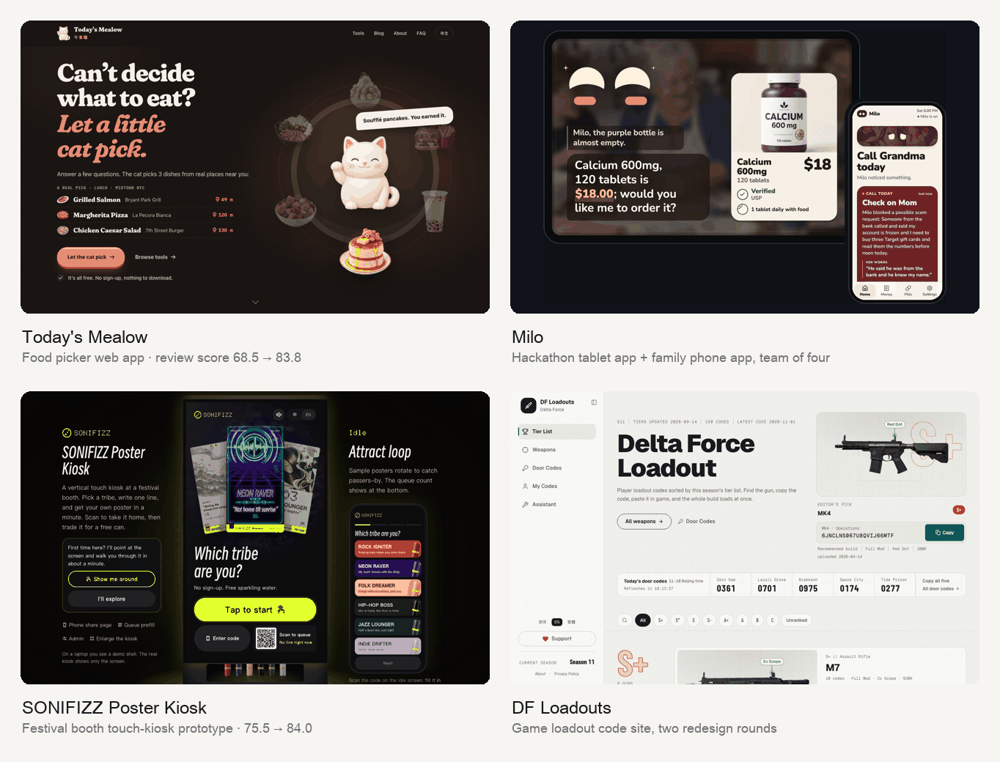
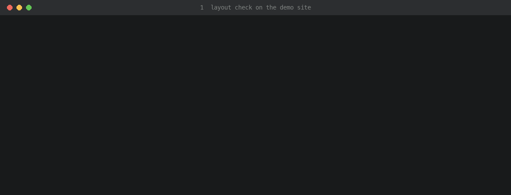

# award-site

**An agent skill for polishing websites, web apps and app interfaces, with Awwwards winners as the bar and reviews you can trust.**

Plain Markdown plus Python scripts, so any coding agent that can read files and run commands can use it; Claude Code and Codex load it as a skill directly.

[中文说明](README.zh.md)

## Polished with award-site



- [Today's Mealow](https://mealow.app/): a web app where a cat picks what you eat from real places nearby.
- [Milo](https://devpost.com/software/milo-shopping-that-understands-older-adults): a hackathon build by a team of four, a voice-first tablet app for older adults plus a phone app for their families.
- [SONIFIZZ Poster Kiosk](https://ekko237.github.io/sonifizz-poster/) ([code](https://github.com/Ekko237/sonifizz-poster)): a touch-kiosk prototype for a festival booth that prints your own poster in a minute.
- [DF Loadouts](https://dfgqm.com/en): a game loadout code site, polished over two redesign rounds.

<sub>Scores are this skill's own 100-point review score, from two independent AI reviewers calibrated on a fixed anchor set, before the first batch and on the version that went live.</sub>

Given the same brief, everyone ships about the same features. What makes one product stand out is visuals, interaction, motion and smoothness, and that is hard to improve with an AI agent alone: it grades its own work generously, small fixes stall, and "make it better" has no finish line. This skill turns polishing into a loop with a real ruler.

Besides the four above, it has polished a campus errand app prototype ([live](https://ekko237.github.io/campus-errand/), [code](https://github.com/Ekko237/campus-errand), Chinese only for now). Anything that runs in a browser fits, because the checks drive a headless browser.

Awwwards is the bar, not a promise: the scored projects above went from 68.5 and 75.5 to 83.8 and 84.0 on its own 100-point ruler, around Honorable Mention level per item. None of them has won an Awwwards award.

How the loop works:

- **Study the bar first**: open 6-8 recent Awwwards / Webby / FWA winners of the same kind, note the techniques worth borrowing.
- **Work in batches**: reviewers hand over one complete issue list, the agent fixes all of it, one commit per fix, then the next review.
- **Reviews you can trust**: two fresh reviewers who did not build it, a fixed anchor set to cancel out harsh or lenient reviewers, and a blind side-by-side against the best version so far that decides whether a batch counts. The 10-item ruler was calibrated on 5 real Sites of the Day and a template site: 10 = top SOTD, 9 = average SOTD, 8 = Honorable Mention.
- **You stay the final judge**: before/after images go to you regularly, because AI reviewers can all miss the same thing; the version you pick becomes the baseline no score overrides.
- **Brakes for every case**: deadlines, being stuck, no progress, flip-flopping.
- **Hackathons and team work**: same bar, design moves before the start, polishing follows the team's checkpoints.



## Try one tool in a minute

The layout checker works on any site, no skill install needed:

```bash
git clone https://github.com/Ekko237/award-site && cd award-site
pip install playwright pillow && playwright install chromium
python3 skills/award-site/scripts/layout_check.py https://your-site.com --out check --keep "main=.your-main-button"
```

You get screenshots at 375, 768, 1024, 1280 and 1440 plus `check/report.json`: horizontal overflow, clipped outlines and shadows, truncated text, headings over two lines, console errors, broken images, tap targets under 44px, text rendered under 12px, and whether your main button is fully in the first screen and not covered by a banner.

## Install

**Claude Code (plugin)**:

```
/plugin install award-site --marketplace Ekko237/award-site
```

On older versions: `/plugin marketplace add Ekko237/award-site`, then `/plugin install award-site@award-site`.

**Any agent (plain skill folder)**:

```bash
bash install.sh                   # ~/.claude/skills and/or ~/.codex/skills, whichever exists
bash install.sh claude            # Claude Code only
bash install.sh codex             # Codex only
bash install.sh /path/to/skills   # any other agent: the folder it loads skills from
```

Agents without a skills folder can be pointed at `skills/award-site/SKILL.md` directly. Then ask it to "polish this site to award level" or "use the award-site skill"; agents with slash commands also take `/award-site`.

## What is inside

- `skills/award-site/SKILL.md`: the loop (goal, process, check and iterate), finish conditions and red lines.
- `references/`: new-site and redesign modes, how to study award sites, the scoring ruler, how to run reviewers, the polish checklist, shipping, hackathons, and lessons from real projects.
- `scripts/` (usage in `references/scripts.md`), all run on real sites:
  - `layout_check.py`: multi-width screenshots and layout checks, key elements in the first screen, states after interactions.
  - `record_moment.py`: frame-by-frame recording of animations on a virtual clock, so reviewers can judge motion from stills.
  - `sound_levels.py`: per-step audio levels, for reviewers who cannot hear in a headless browser.
  - `review_prompt.py`: blind reviewer prompts with anonymized screenshot sets.
  - `calibrate.py`: anchor calibration, averaging, Awwwards-weighted scores, and the verdict from the blind side-by-side.
  - `side_by_side.py`: labelled before/after images from URLs or files.
  - `seo_keep.py`: titles, descriptions, canonicals and structured data before vs after, so a redesign never loses search fields.
  - `wait_live.py`: waits until the live page and its CSS and JS really serve the new version.
  - `asset_check.py`: every local file every page references exists, without a browser.
  - `snapshot.py`: review snapshots exported from commits only, so nothing uncommitted turns into a 404.
  - `split_commits.py`: splits piled-up changes into one commit each by keyword.
- `templates/`: the polish brief, iteration log, reviewer prompt and reviewer config.

## Requirements

Python 3, Playwright with Chromium, Pillow; `asset_check.py` also needs beautifulsoup4 and tinycss2, `seo_keep.py` needs requests and beautifulsoup4. Optional: a front-end design skill such as design-taste-frontend, and an image generator, since generated pictures are preferred over drawn SVG.

## License

MIT
