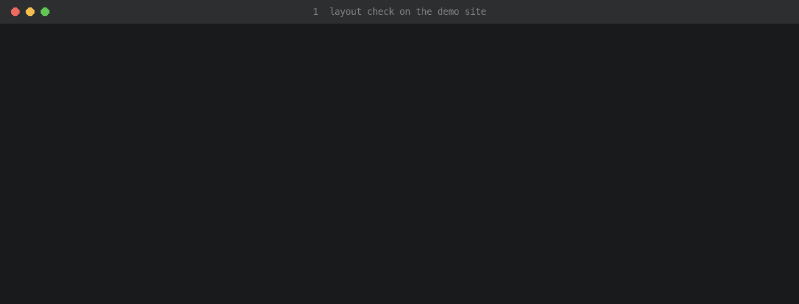

# award-polish

[English](README.md) | [简体中文](README.zh.md)

award-polish 是一个 Claude Code 和 Codex 技能，用同一套标准反复评审和打磨网站、网页应用和能在浏览器里打开的原型。

## 适合谁

用 AI 做落地页、作品集或网页应用的个人开发者和小团队。比如，改版一个网页游戏首页时，可以先查手机上主按钮有没有被挡住，再把改动和目前最好的版本并排评审。

## 为什么现在就试

当页面已经能用、下一步却只有一句「再打磨一下」，就可以请两位独立评审用同一套标准给出完整的修改清单。每批改完，用固定样本校准评分，再和目前最好的版本并排盲评。你选定的版本是后续基准。

v1.0.4 的 10 项评分标准用 5 个真实的 Awwwards 每日最佳网站和 1 个模板站校准过。10 分是顶尖每日最佳，9 分是平均每日最佳，8 分是荣誉提名。

```bash
npx skills add https://github.com/Ekko237/award-polish -a claude-code -a codex
```

[用法](#快速上手) · [反馈问题](https://github.com/Ekko237/award-polish/issues) · [贡献指南](CONTRIBUTING.md) · [ClawHub](https://clawhub.ai/ekko237/skills/award-polish)

## 环境要求

- 安装技能需要 Git 和带 `npx` 的 Node.js。在项目目录运行上面的命令，提示选择安装范围时选 **Project**。如果终端无法交互，在命令末尾加 `-y`，按默认设置装到当前项目。
- 完整流程需要能运行已登录的 Claude Code 或 Codex。其他能加载技能文件夹的助手尚未测试。
- 布局检查需要 Git、Python 3（含 `venv`）、Playwright 的 Chromium 和 Pillow。下面的例子会安装 Python 依赖和浏览器，无需登录。
- `asset_check.py` 另需 beautifulsoup4 和 tinycss2。 `seo_keep.py` 另需 requests 和 beautifulsoup4。

## 快速上手

### 先跑一次本地布局检查

在空目录里运行以下命令。示例页面由本地 Python 服务提供。首次安装要下载 Chromium。

```bash
git clone https://github.com/Ekko237/award-polish
cd award-polish
python3 -m venv .venv
.venv/bin/python -m pip install playwright pillow
.venv/bin/python -m playwright install chromium
mkdir demo
cat > demo/index.html <<'HTML'
<!doctype html>
<html lang="en">
<meta charset="utf-8">
<meta name="viewport" content="width=device-width, initial-scale=1">
<title>Layout check demo</title>
<h1>Layout check demo</h1>
<button id="start" style="min-height:44px">Start</button>
</html>
HTML
.venv/bin/python -m http.server 8765 --bind 127.0.0.1 --directory demo
```

打开第二个终端，进入刚克隆的 `award-polish` 目录，运行检查。

```bash
.venv/bin/python skills/award-polish/scripts/layout_check.py http://127.0.0.1:8765/ --out check --keep 'start=#start'
```

打开 `check/report.json`，查看横向溢出、文字截断和 `Start` 按钮是否完整露出、有没有被遮挡。`check/` 中还有 375、768、1024、1280 和 1440 像素宽的截图。完成后，在第一个终端按 Ctrl+C 停掉服务。

### 启动打磨流程

按上面的方式安装到项目后，可以在 `.agents/skills/award-polish/SKILL.md` 找到技能。安装器也会为 Claude Code 建立链接。在项目里打开 Claude Code 或 Codex，告诉它「按 award-polish 打磨这个网站。先检查本地首页，保留现有主流程」。查看项目根目录的 `ITERATION_LOG.md`，确认第一行写的是新建网站还是改版。[完整流程](skills/award-polish/SKILL.md) · [脚本用法](skills/award-polish/references/scripts.md)

## 什么时候不适合用

- 只需修一个已知的 CSS 问题时，直接修复并检查受影响的页面更省事。
- 原生界面无法在浏览器中打开时，布局检查无法运行。
- 如果你需要保证获奖，这个流程无法提供保证。Awwwards 是对照标准，下面的项目都没有获得过 Awwwards 奖项。

## 和其他做法相比

| 做法 | 适用场景 | 得到什么 |
| --- | --- | --- |
| 手动看页面 | 已知问题，改动范围小 | 针对具体页面和状态的检查 |
| 只跑布局检查 | 想找多种屏宽下的布局问题 | 五种宽度的截图和 JSON 报告 |
| 完整 award-polish 流程 | 想分批改进视觉、交互和动效 | 两位独立评审、校准后的评分和并排盲评 |

## 用它打磨过的作品


- [Island Evolution](https://islandevolution.com/)：像素解谜游戏的官网，最值得看的是往下滚动时一步步演示一局游戏的那一段。
- [今食喵 Today's Mealow](https://mealow.app/)：让小猫从附近真实的店里帮你挑吃什么的网页应用。
- [Milo](https://devpost.com/software/milo-shopping-that-understands-older-adults)：黑客松上四人队做的作品，老人开口就能用的平板端，加上子女用的手机端。
- [SONIFIZZ 声汽海报机](https://ekko237.github.io/sonifizz-poster/)（[源码](https://github.com/Ekko237/sonifizz-poster)）：音乐节展位上的竖屏触摸机原型，一分钟印出一张自己的海报。
- [顺路侠](https://ekko237.github.io/shunluxia-campus-errand/?lang=zh)（[源码](https://github.com/Ekko237/shunluxia-campus-errand)）：校园跑腿互助 App 原型。
- [三角洲国际服改枪码](https://dfgqm.com/)：游戏改枪码站，做了两轮改版。



## 其他安装方式

<details>
<summary>Claude Code 插件</summary>

Claude Code：

```bash
claude plugin install award-polish --marketplace Ekko237/award-polish
```

</details>

<details>
<summary>Codex 插件</summary>

Codex：

```bash
codex plugin marketplace add Ekko237/award-polish
codex plugin add award-polish@award-polish
```

</details>

<details>
<summary>文件夹安装</summary>

```bash
git clone https://github.com/Ekko237/award-polish && cd award-polish && bash install.sh
```

安装脚本要用 rsync。已有 `~/.claude` 或 `~/.codex` 时，技能会装进对应的 `skills/award-polish`。两个都有就都装。两个都没有时，脚本会停下，并要求你给出技能目录。

更新：在这份仓库里先 `git pull`，再运行 `bash install.sh`。复制时会保留你在已安装文件夹里自己加的文件。

已经有一份仓库时：

```bash
bash install.sh
```

只装 Claude Code，或只装 Codex：

```bash
bash install.sh claude
bash install.sh codex
```

装到指定目录：

```bash
bash install.sh /你的/skills/目录
```

Windows 可以把 `skills/award-polish` 复制到 `%USERPROFILE%\.claude\skills\award-polish` 或 `%USERPROFILE%\.codex\skills\award-polish`。装了 `rsync` 的 Git Bash 可以直接运行 `install.sh`。

也可以让 Claude Code 或 Codex 直接读 `skills/award-polish/SKILL.md`。斜杠命令是 `/award-polish`。

</details>

## 许可证

[MIT](LICENSE) · [更新日志](CHANGELOG.md)
