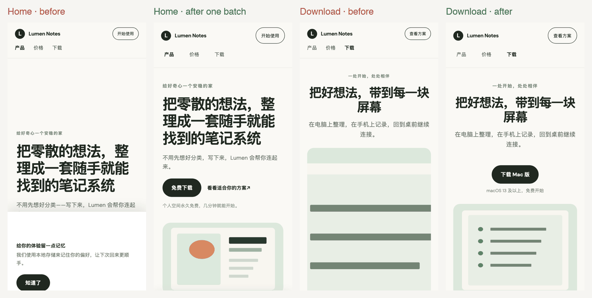

# award-site

**一个给 Claude Code / Codex 用的技能：把网页产品打磨到 Awwwards 获奖水平，评审分数靠得住。**

[English](README.md)



<sub>在一个故意埋了问题的演示站上跑了一批：第一次布局体检，15 个「页面 × 宽度」组合全部不过；16 个小提交以后，14 个通过。剩下那一个是手机上首页标题排成三行，标题文字属于搜索字段，改版不能改字。</sub>

同一份需求，大家做出来的功能差不多，拉开差距靠视觉、交互、动效和流畅度。光靠 AI 自己打磨很难做好：它给自己打分偏松，小修小补会卡住，「做得更好」也没有终点。这个技能把打磨变成一个有尺子的循环：

- **先看标杆**：实际打开 6-8 个近期同类的 Awwwards / Webby / FWA 获奖站，记下能借的手法。
- **按批推进**：评审一次给出完整问题清单，AI 一口气改完，一条改动一个提交，再请下一次评审。
- **评审靠得住**：每次开两个没参与开发的新评审；用一份固定的定标卷抵消评审偏严或偏松；这一批算不算数，看它和目前最好版本的逐项盲比。10 项打分的尺子拿 5 个真实的 Site of the Day 和 1 个模板站校准过：10 分 = 顶尖 SOTD，9 分 = 一般 SOTD，8 分 = Honorable Mention。
- **最后由你拍板**：定期把前后对比图发给你，因为 AI 评审会集体看走眼；你挑中的版本就是基准，评审分再高也不推翻。
- **刹车写全**：截止时间、卡住、没进展、来回摆，各有处理办法。
- **黑客松和多人协作**：标准不降，设计挪到开赛前做，打磨跟着团队的检查点。


## 一分钟试一个工具

布局体检脚本对任何网站都能用，不用先装技能：

```bash
git clone https://github.com/Ekko237/award-site && cd award-site
pip install playwright pillow && playwright install chromium
python3 skills/award-site/scripts/layout_check.py https://你的网站 --out check --keep "main=.你的主按钮"
```

会得到 375、768、1024、1280、1440 五档宽度的截图和 `check/report.json`：横向溢出、被裁掉的描边和阴影、被截断的文字、超过两行的标题、控制台报错、坏图、小于 44px 的点击区、实际显示小于 12px 的字，还有主按钮在不在第一屏、有没有被横幅盖住。

## 安装

**Claude Code（插件）**：

```
/plugin install award-site --marketplace Ekko237/award-site
```

旧版本先 `/plugin marketplace add Ekko237/award-site`，再 `/plugin install award-site@award-site`。

**Codex 或 Claude Code（普通技能）**：

```bash
bash install.sh          # 自动装到 ~/.claude/skills 和/或 ~/.codex/skills
bash install.sh claude   # 只装 Claude Code
bash install.sh codex    # 只装 Codex
```

装好后，说「把这个网站打磨到获奖水平」「改版一下这个网站」，或者直接用 `/award-site`。技能正文是英文写的，AI 跟你说话照样用你的语言。

## 里面有什么

- `skills/award-site/SKILL.md`：循环本身（目标、过程、检查迭代）、收工条件和红线。
- `references/`：新站和改版两种模式、怎么看获奖站、打分的尺子、怎么开评审、打磨清单、上线、黑客松，以及从真实项目里攒下的经验。
- `scripts/`（用法见 `references/scripts.md`），都在真实网站上跑过：
  - `layout_check.py`：多宽度截图和布局检查、首屏关键元素、操作后的状态。
  - `record_moment.py`：用虚拟时钟逐格录动效，评审看静态图也能打动效分。
  - `sound_levels.py`：逐步记录音量电平，给在无头浏览器里听不到声音的评审看。
  - `review_prompt.py`：生成盲评提示词，截图换成看不出版本的目录名。
  - `calibrate.py`：定标卷校正、取平均、Awwwards 加权分，并按盲比定结论。
  - `side_by_side.py`：从网址或图片拼出带标签的前后对比图。
  - `seo_keep.py`：对照改版前后的标题、描述、规范链接和结构化数据，改版不丢搜索字段。
  - `wait_live.py`：等线上页面和它引用的样式、脚本真的换成新版本。
  - `asset_check.py`：不开浏览器，查全站每个页面引用的本地文件在不在。
  - `snapshot.py`：给评审的快照只从提交导出，没提交的文件不会变成 404。
  - `split_commits.py`：工作区攒了几件改动时，按关键词拆成一件一个提交。
- `templates/`：任务说明、迭代日志、评审提示词和评审配置。

## 需要什么

Python 3、Playwright 和 Chromium、Pillow；`asset_check.py` 还要 beautifulsoup4 和 tinycss2，`seo_keep.py` 要 requests 和 beautifulsoup4。可选：一个前端设计规则技能（比如 design-taste-frontend），以及一个生图工具，画面优先用生成图。

## 许可

MIT
